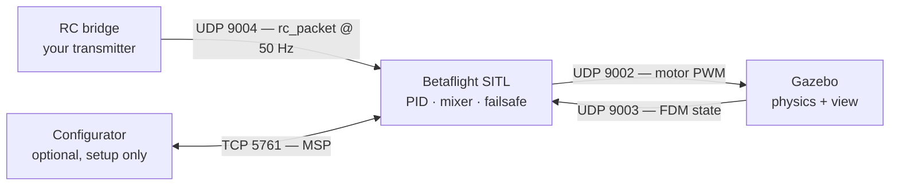

# SITL Gazebo Flight Manual

Build Betaflight as a Linux process, fly it in Gazebo Harmonic, and drive it with
your own RC transmitter — no flight controller, no props, no crashes that cost money.

Written against `2026.6-maintenance`, config `SITL_GAZEBO`, Gazebo Harmonic 8.15.0
in the `gz-env` distrobox.

---

## What you are wiring together

Four processes talk over loopback sockets. Betaflight computes motor outputs and
ships them to Gazebo; Gazebo runs the physics and ships back the aircraft state;
your radio feeds stick positions in; the Configurator is optional and only needed
for setup.



The 9002/9003 pair is the simulation loop — break either direction and the aircraft
freezes or falls. The RC feed is separate, and it must keep streaming: a gap reads
as receiver loss and triggers failsafe.

---

## 1. Build the firmware

SITL is an ordinary make target, not a special mode. It needs **no ARM toolchain** —
`src/platform/SIMULATOR/mk/SITL.mk` sets `PLATFORM_SDK := none`, so
`mk/tools_check.mk` skips validation and the build uses your host `gcc`.

```sh
cd ~/dev/betaflight
make CONFIG=SITL_GAZEBO

# -> obj/main/betaflight_SITL_SITL_GAZEBO.elf   (run this one)
# -> obj/betaflight_2026.6.3_SITL_SITL_GAZEBO    (identical copy)
```

The `SITL_GAZEBO` config is what makes the bridge line up: `ENABLE_GAZEBO_BRIDGE 1`
for the Harmonic plugin's frame conventions, `YAW_MOTORS_REVERSED 1` because the
simulated quad is a props-in airframe, and `USE_FLIGHT_PLAN`.

> Plain `make TARGET=SITL` builds too, but it assumes the older X-Plane / RealFlight
> conventions and your yaw will fight you.

---

## 2. Build the Gazebo bridge plugin

Gazebo does not speak Betaflight's protocol on its own. The `BetaflightPlugin`
system plugin from `betaflight/aeroloop_gazebo` binds UDP 9002, converts motor PWM
into rotor forces, and sends state back on 9003.

Build it inside `gz-env`, which already has Harmonic 8.15.0 and every `libgz-*-dev`
package the plugin needs.

```sh
distrobox enter gz-env

git clone -b gz https://github.com/betaflight/aeroloop_gazebo.git ~/dev/aeroloop_gazebo
cd ~/dev/aeroloop_gazebo
git checkout a6c16d2d653932a96ced279522ba39b6da15f78c

cd plugins && mkdir -p build && cd build
cmake .. && make -j$(nproc)
```

That commit is the revision Betaflight pins in `.devcontainer/containerfile.gazebo`,
so it is what this firmware is known to work against. Distrobox shares your home
directory, so the clone is visible inside and outside the container.

> **Gotcha.** Inside `gz-env`, your `~/.local/bin/gz` wrapper is still on `PATH` and
> shadows the real `/usr/bin/gz` — calling plain `gz` there makes it re-enter the
> container and recurse. Inside the box, always spell it `/usr/bin/gz`.

---

## 3. Start Gazebo

Start the simulator **first**, so the plugin owns port 9002 before Betaflight begins
transmitting to it. Fly `worlds/test_betaflight.sdf` — it includes
`model://test_quad`, the only model in the repo that carries `BetaflightPlugin`.

```sh
cd ~/dev/aeroloop_gazebo

export SDF_PATH=$PWD/models:$SDF_PATH
export GZ_SIM_RESOURCE_PATH=$PWD/worlds:$GZ_SIM_RESOURCE_PATH
export GZ_SIM_SYSTEM_PLUGIN_PATH=$PWD/plugins/build:$GZ_SIM_SYSTEM_PLUGIN_PATH

/usr/bin/gz sim -r -v 4 worlds/test_betaflight.sdf
```

`-r` starts physics running rather than paused — without it the aircraft never moves
and the FDM feed stays silent. `-v 4` is verbose logging, which is how you confirm
the plugin loaded. Add `-s --headless-rendering` for a server-only run with no window.

**Looks right:** a quad on a ground plane, and no `failed to bind with 127.0.0.1:9002`
in the log. That bind error means something already holds the port — usually a Gazebo
you forgot to close.

---

## 4. Start Betaflight

Run the binary from a scratch directory. On first start it writes a 32 KB
`eeprom.bin` into the working directory — that file is your saved configuration, and
deleting it is how you factory-reset.

```sh
mkdir -p ~/sitl-run && cd ~/sitl-run
~/dev/betaflight/obj/main/betaflight_SITL_SITL_GAZEBO.elf
```

It should claim all its sockets:

```
[SITL] init PwmOut UDP link to gazebo 127.0.0.1:9002...0
[SITL] start UDP server @9003...0
[SITL] start UDP server for RC input @9004...0
[FLASH_Unlock] created 'eeprom.bin', size = 32768
```

Useful flags:

| Flag | Effect |
| --- | --- |
| `--ip <address>` | Simulator host, if Gazebo is not on this machine |
| `--gpx` | Log the GPS track to `sitl_track.gpx` |
| `--config <file>` | Apply a CLI config file to the EEPROM and exit |
| `--help` | Full list |

---

## 5. Connect your transmitter

SITL takes RC over UDP 9004 as a 40-byte frame: a little-endian `double` timestamp
followed by sixteen `uint16` channels in microseconds, in **AETR** order.
`FEATURE_RX_UDP` is already the default receiver for SITL, so there is nothing to
configure in Betaflight.

Put your radio into **USB Joystick** mode — on EdgeTX that is *System → Hardware →
USB mode*, or the prompt you get when plugging in — then plug it in. It appears as
`/dev/input/js0`.

Find your axis numbers first:

```sh
cd ~/dev/betaflight
./test_tools/rc_joystick_bridge.py --monitor

# move one stick at a time and watch which axis reacts
# axes seen [0, 1, 2, 3]  ch1-8 1500 1500 1000 1500 ...
```

The default map assumes axes 0–3 are roll, pitch, throttle, yaw and axes 4–7 are
AUX1–4. Remap if your radio differs, and invert throttle if it runs backwards:

```sh
./test_tools/rc_joystick_bridge.py --invert 2

# custom mapping, 1-based channels:
#   --map 0:1,1:2,2:3,3:4,4:5,5:6
```

> **Keep it running.** The bridge must stream continuously. Stop it and Betaflight
> sees no frames, declares receiver loss and failsafes — mid-air that means a drop.
> Leave the terminal open for the whole session.

---

## 6. Arm and fly

Betaflight will not arm without a switch assigned to the ARM mode. Point Betaflight
Configurator at **127.0.0.1:5761** using its manual TCP connection, assign ARM to an
AUX channel in the Modes tab, and save.

The equivalent as a CLI config file, applied once with `--config` — ARM on AUX1
above 1700:

```
aux 0 0 0 1700 2100 0 0
save
```

```sh
~/dev/betaflight/obj/main/betaflight_SITL_SITL_GAZEBO.elf --config arm.txt
```

Then flick the arm switch, feed in throttle, and the quad lifts off in the Gazebo
window. Stick response, PID tuning, rates, blackbox — everything behaves as it does
on hardware, because it *is* the hardware firmware.

**Start order:** Gazebo → Betaflight → RC bridge. Starting Betaflight first is
harmless, but it logs nothing useful until the simulator answers on 9003.

---

## Port map

Every hop is loopback. Nothing is exposed off the machine unless you pass `--ip`.

| Port | Dir | Carries | Between |
| --- | --- | --- | --- |
| UDP 9001 | out | Raw PWM, 1100–1900 | SITL → RealFlight bridge |
| UDP 9002 | out | Motor PWM, 4 × float | SITL → Gazebo |
| UDP 9003 | in | Flight dynamics state | Gazebo → SITL |
| UDP 9004 | in | `rc_packet`, 16 channels | RC bridge → SITL |
| TCP 5761 | both | MSP over emulated UART1 | Configurator ↔ SITL |
| TCP 576*x* | both | UART*x*, opened on demand | any serial peripheral |

---

## When it does not work

**The quad sits there and nothing moves.**
Physics is paused. Gazebo starts paused unless you pass `-r`, and with no physics
there is no FDM packet, so Betaflight never sees an attitude. Press play in the GUI
or restart with `-r`.

**It yaws the wrong way or flips on takeoff.**
Almost always the wrong build. `make TARGET=SITL` uses the legacy X-Plane /
RealFlight frame conventions; the Harmonic plugin needs `ENABLE_GAZEBO_BRIDGE 1` and
`YAW_MOTORS_REVERSED 1`, which only `make CONFIG=SITL_GAZEBO` sets.

**No `/dev/input/js0` when the radio is plugged in.**
Check the radio is in USB Joystick mode rather than storage or serial mode, and
replug. If it still does not appear, the legacy joystick driver may not be loaded:
`sudo modprobe joydev`. A permission error instead means your user is not in the
`input` group.

**Betaflight keeps failsafing.**
The RC stream stopped or never started. Confirm the bridge is still running and that
Betaflight logged the first frame — it prints
`[SITL] new rc 40: … AETR: 1500 1500 1000 1500`. If that line never appears, nothing
is reaching port 9004.

**`failed to bind with 127.0.0.1:9002`.**
The plugin could not take its port, so it aborts and you get a world with no
Betaflight link. Another Gazebo is still alive — find it with
`ss -lnup | grep 9002` and kill it.

**Calling `gz` inside the container hangs or recurses.**
`~/.local/bin/gz` is a wrapper that runs `distrobox enter gz-env -- gz`. Inside the
container it is still first on `PATH`, so it calls itself. Use `/usr/bin/gz`.

---

## What was actually tested

Which parts of this were run end to end, and which were read out of the source —
the difference matters the first time something misbehaves.

- **Verified by running it:** the firmware build; the binary starting and claiming
  UDP 9003, UDP 9004 and TCP 5761; and RC ingestion — a hand-built 40-byte frame
  produced `[SITL] new rc 40: … AETR: 1500 1500 1000 1500 AUX1-4: 1000 1000 1000 1000`,
  confirming the bridge's packet format and channel order against the real binary.
- **Verified by reading the source:** the plugin's 9002/9003 bindings, the world and
  model that carry `BetaflightPlugin`, the pinned commit, and `gz-env` having every
  build dependency.
- **Not yet run:** the plugin build, the Gazebo session, arming, and flight. No
  transmitter was attached, so the joystick path is untested against real hardware.

> **Stale doc warning.** The in-tree `src/platform/SIMULATOR/target/SITL/README.md`
> still describes Gazebo 8 on Ubuntu 16.04, points at a path that moved to
> `src/platform/SIMULATOR/link/sitl.ld`, and gives the EEPROM size as 8192 bytes when
> the binary creates 32768. Its build command and port numbers are still correct;
> trust little else in it.

---

Bridge script: `test_tools/rc_joystick_bridge.py` ·
Firmware config: `src/config/configs/BTFL/SITL_GAZEBO/config.h` ·
Plugin: `betaflight/aeroloop_gazebo@a6c16d2d`
